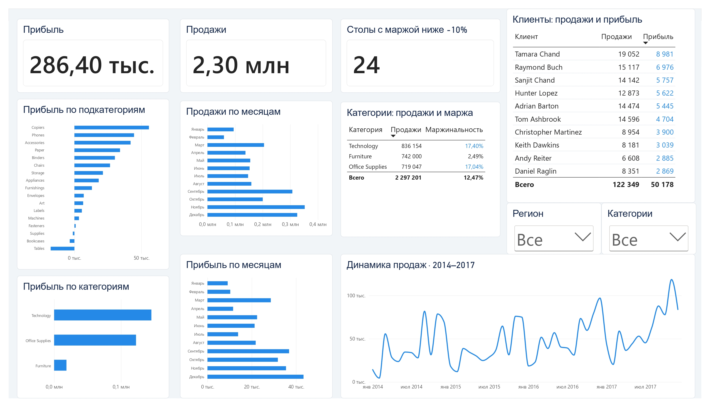

# Superstore Sales & Profitability Analysis

## Project Overview

This project analyzes retail sales and profitability using the Superstore dataset covering 2014–2017. The analysis focuses on sales trends, product performance, regional differences, customer segments, and products generating losses.

The project combines SQL analysis with an interactive Power BI dashboard to explore business performance and identify areas that may require further investigation.

## Tools Used

- **SQL (SQLite):** data quality checks, aggregations, profitability analysis, and customer analysis.
- **Power BI:** interactive dashboard, KPI cards, filters, and time-series visualizations.
- **DAX:** profit margin measures and product-level profitability calculations.

## Business Questions

- How did sales and profit change over time?
- Which product categories and sub-categories contributed most to profit?
- How did profitability differ across regions and customer segments?
- How did sales and profit vary across discount levels?
- Which products in Furniture → Tables had a profit margin below −10%?

## Key Findings

- The dataset contains **9,994 order lines** and **5,009 distinct orders**.
- The data covers the period from January 2014 to December 2017.
- **24 products** in Furniture → Tables have a profit margin below −10%.
- Comparing sales, profit, and profit margin helps distinguish high sales volume from strong profitability.

## Dashboard Preview

## Repository Structure

- `successful_project.pbix` — interactive Power BI report.
- `successful_project.pdf` — PDF export of the report.
- `data/Sample - Superstore.csv` — source dataset used by Power BI.
- `data/superstore.db` — SQLite database used for SQL analysis.
- `sql/superstore_analysis.sql` — SQL queries for data checks and business analysis.
- `screenshots/dashboard.jpg` — dashboard preview.

## How to Run

### Power BI

1. Open `successful_project.pbix` in Power BI Desktop.
2. If prompted, update the source path to `data/Sample - Superstore.csv`.
3. Refresh the data if necessary.

### SQL

1. Open `data/superstore.db` in DBeaver or another SQLite-compatible client.
2. Confirm that the database contains the `orders` table and the expected column names.
3. Open `sql/superstore_analysis.sql`.
4. Execute the full script to review the data checks and analysis results.

## Notes

Profit margin is calculated as:

`Profit Margin = Total Profit / Total Sales`

For the Furniture → Tables analysis, products are classified as unprofitable when their profit margin is below −10%.

The results describe patterns in the dataset and do not, by themselves, establish the causes of losses.

